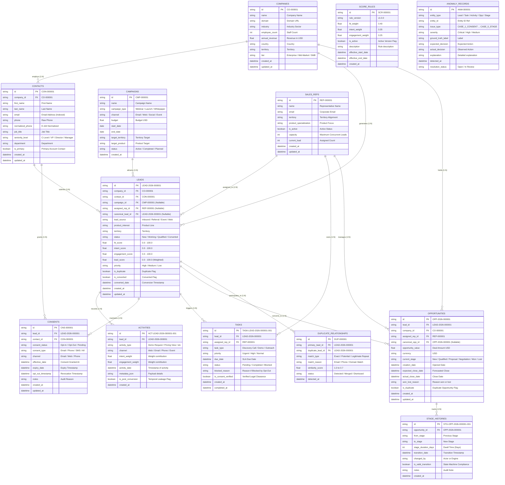

# Database Schema & Entity Relationship Diagram (ERD)

## SMARTLEAD AI Platform
**Architecture**: Relational Star/Snowflake Hybrid OLTP Schema  
**Database Engine**: SQLite with enforced Foreign Keys (`PRAGMA foreign_keys = ON`)  
**ORM Layer**: SQLAlchemy 2.0  

---

## 1. Entity-Relationship Diagram (ERD)

---

## 2. Relational Cardinality & Integrity Rules

1. **Company to Contacts (`1:N`)**: A single company can have multiple contacts. If a company record is removed, orphan cascade cleanup occurs.
2. **Contact to Leads (`1:N`)**: Multiple leads over time can originate from the same contact persona (e.g. repeated interest).
3. **Lead to Activities (`1:N`)**: Touchpoints belong strictly to a single lead. Cascade delete applies on lead deletion.
4. **Lead to Consent (`1:1` or `1:N`)**: Consent is tracked per lead and contact, preserving full revocation history in `consent_histories`.
5. **Opportunity to StageHistory (`1:N`)**: Every lifecycle stage change is appended as an immutable event record. Historical states are never overwritten.
